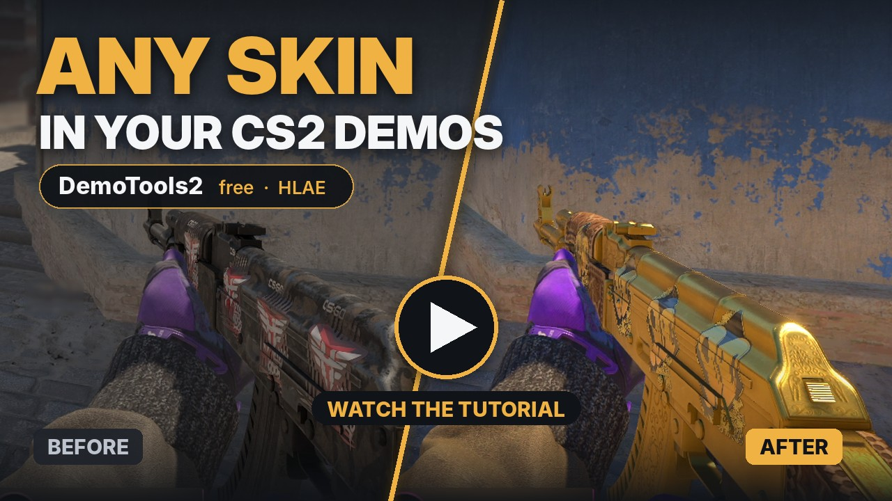
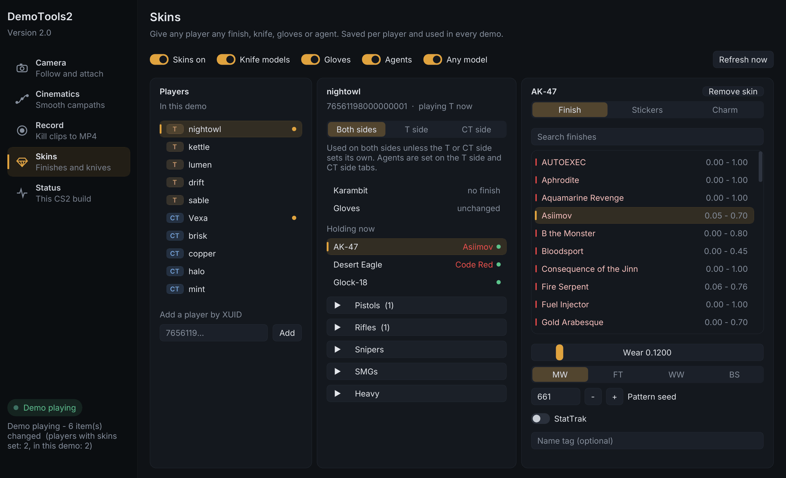
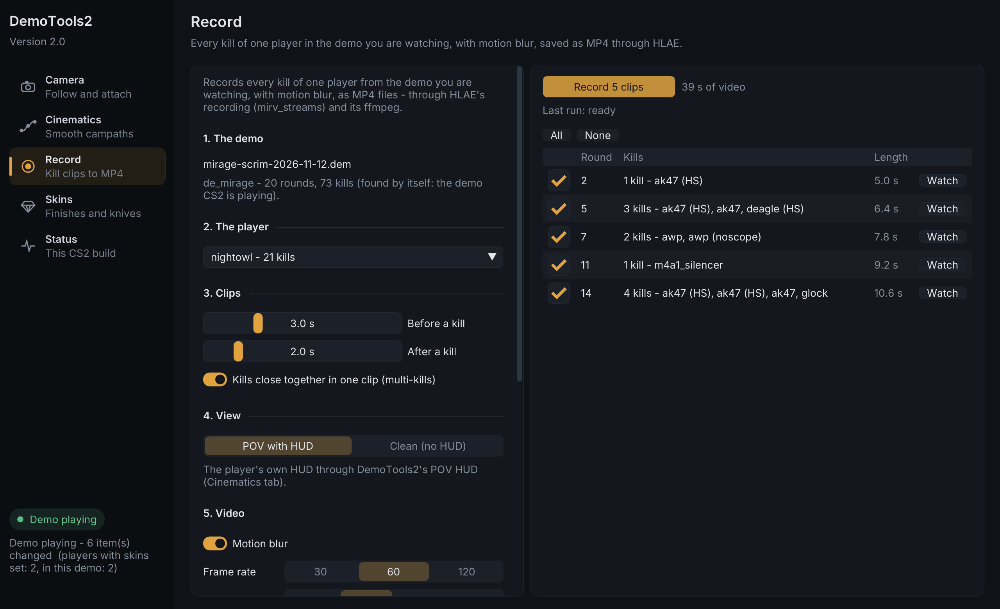
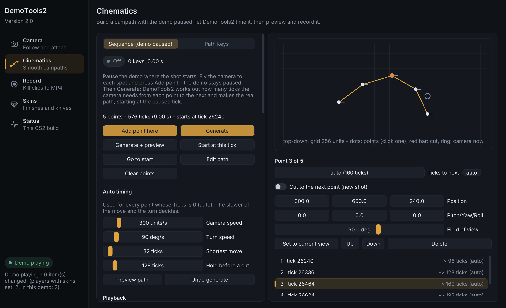
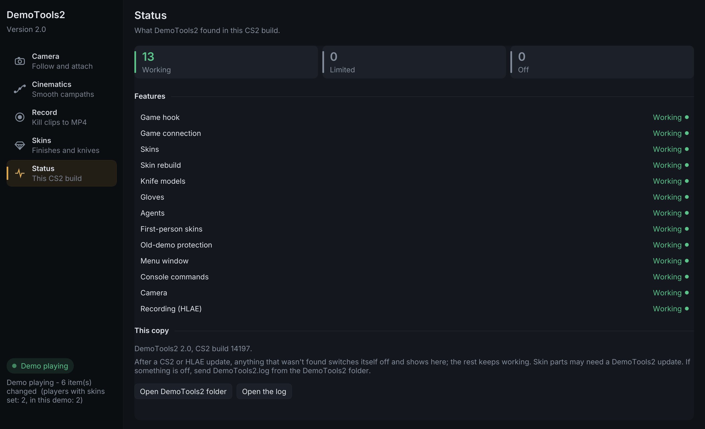
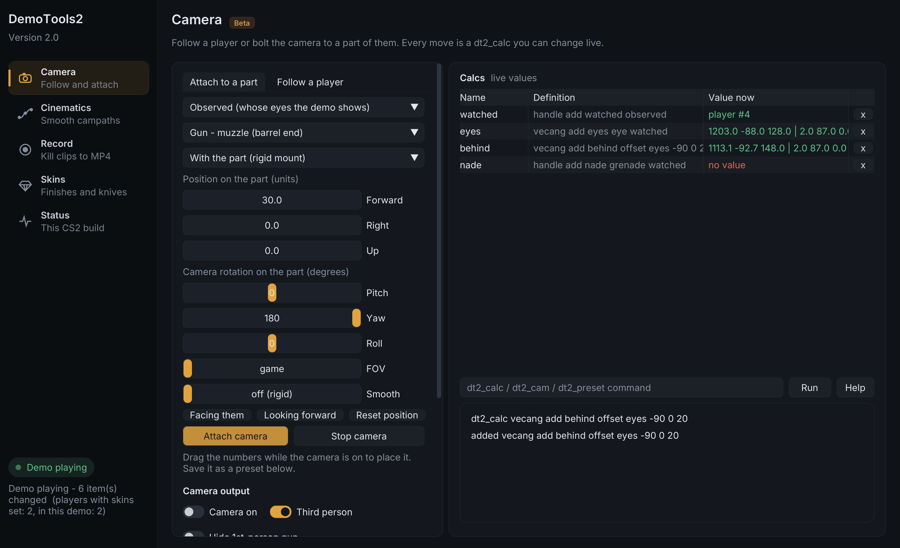

<div align="center">
  <a href="https://youtu.be/inYPRkl38-4">
    
  </a>
  <h1>DemoTools2</h1>
  <p>
    <b>Skins, kill clips and cinematics for your CS2 demos, right inside HLAE.</b><br>
    Any knife, gloves, agent, sticker and charm; every kill of a player recorded to MP4 with motion blur;
    smooth campaths built with the demo paused. Free and open source.
  </p>
  <p>
    <a href="https://youtu.be/inYPRkl38-4"></a>
    <a href="https://github.com/janglijoshi/DemoTools2/releases"></a>
    
    
    <a href="LICENSE"></a>
  </p>
  <p>
    <a href="https://youtu.be/inYPRkl38-4"><b>▶ Watch the 6-minute tutorial</b></a> ·
    <a href="https://github.com/janglijoshi/DemoTools2/releases"><b>⬇ Download</b></a> ·
    <a href="https://github.com/janglijoshi/DemoTools2/issues"><b>🐞 Report a bug</b></a>
  </p>
</div>

---

## 🎬 New here? Watch this first

The video covers everything from download to your first skinned demo: installing, launching CS2 through HLAE,
loading DemoTools2, and the skins menu (knives, gloves, agents, guns, stickers, charms, T/CT loadouts). It was made
before 2.0, so the window looks different now (a sidebar instead of tabs); the steps are the same. Record and
Cinematics are explained [further down](#record-kill-clips).

**▶ [Watch it on YouTube](https://youtu.be/inYPRkl38-4)**

## ✨ What it does

| Feature | What you get |
|---|---|
| 🔪 **Knives** | Any knife model, with its own animations, and any finish |
| 🧤 **Gloves** | Any glove type and finish |
| 🕵️ **Agents** | A different agent for T and CT |
| 🔫 **Guns** | Any finish, wear, pattern seed, StatTrak counter and name tag |
| 🏷️ **Stickers** | Up to 5 per gun, searchable across 11,000+ stickers |
| 🔑 **Charms** | Any charm, with a pattern number |
| 🔄 **T / CT loadouts** | Different skins per side, switched automatically at half time |
| 🎯 **Only your guns** | Only guns the player owns change; a gun picked up from someone else keeps its skin |
| 🕰️ **Older demos** | Works with demos recorded on earlier CS2 versions |
| 🎞️ **Record** | Every kill of one player, found in the demo file, recorded by itself to MP4 with motion blur (one file per clip and/or all joined), 4:3 stretched to 16:9 |
| 🎬 **Cinematics** | Build a campath with the demo paused and let DemoTools2 time it; hotkeys, orbit and dolly moves, HLAE campath files, and recording the path to MP4 |
| 🎥 **Camera** | Follow a player or bolt the camera to their gun, head or grenade, live calcs and presets (beta) |
| 🩺 **Status** | After a CS2 or HLAE update, it shows what works and switches off what doesn't |

<p align="center">
  
  
  
  
</p>
<p align="center"><sub>The 2.0 window: pick a page in the sidebar. Skins, Record, Cinematics and Status shown.</sub></p>

## 🆕 New in 2.0

* **Record:** pick a player and press *Record*: every kill of theirs in the demo becomes an MP4 clip with motion
  blur, plus one video with all of them joined.
* **Cinematics:** pause the demo, add camera points, press *Generate*: DemoTools2 times the path for you. Hotkeys,
  cuts, orbit / dolly moves, and recording the path to MP4.
* **A new window:** sidebar navigation, page headers, and a Status page with summary tiles.
* **MIT License:** DemoTools2 is now open source.

Everything else is in the [changelog](CHANGELOG.md).

## 🚀 Quick start

1. **Download** `DemoTools2.dll` from [Releases](https://github.com/janglijoshi/DemoTools2/releases) and put it in its own folder.
2. **Start CS2 through [HLAE](https://www.advancedfx.org/)** with `-insecure`.
3. **Load it** in the CS2 console:
   ```
   mirv_loadlibrary "C:\path\to\DemoTools2\DemoTools2.dll"
   ```
4. **Play a demo** and press **Insert** to open the menu. Pick a page in the sidebar: **Skins**, **Record**,
   **Cinematics**, **Camera** or **Status**.

Your skins save automatically and come back in every demo where that player appears. To record, Record and
Cinematics use HLAE's own recording, so set up ffmpeg in HLAE once (*File → Settings*).

## 🔒 Is it safe?

- It's not a separate injector: HLAE loads it with its own `mirv_loadlibrary` command, after the game has started.
- It refuses to run unless CS2 was started with `-insecure`, which keeps the game off VAC-secured servers.
- It only changes anything during demo playback.
- The source code is right here.

Only use it in demos, the way the tutorial shows.

## 🐞 Found a bug?

[Open an issue](https://github.com/janglijoshi/DemoTools2/issues) and attach:

1. `DemoTools2.log` from the DemoTools2 folder
2. a screenshot of the **Status** page
3. `DemoTools2.previous.log` if CS2 crashed

> Free and open source under the [MIT License](LICENSE). Not affiliated with Valve or the HLAE / advancedfx project.

---

# 📖 Full guide

DemoTools2 (formerly DemoSkins) is loaded into CS2 by HLAE. Its window has five pages, picked in the sidebar on the left:

* **Camera** (beta; `dt2_calc` / `dt2_cam` / `dt2_preset`): attach the camera to a player, their gun or their grenade
  and follow it smoothly, like `mirv_calc` + `mirv_cam` in HLAE for CS:GO. Record it with HLAE's `mirv_streams`.
* **Cinematics** (`dt2_campath`): campaths built with the demo paused and timed by DemoTools2, live path keys, quick
  orbit / dolly moves, hotkeys, and recording the path to MP4.
* **Record** (`dt2_record`): every kill of one player in the playing demo, recorded to MP4 with motion blur.
* **Skins**: choose a player in a CS2 demo by their XUID (SteamID64), then give their guns, knife and
  gloves any finish, wear, pattern seed, StatTrak counter, name tag, **stickers** and a **charm**, and change their
  **agent** (player model). Each player can have a separate **T side** and **CT side** loadout. Only that player's
  items change. It works the way nSkinz did for CS:GO.
* **Status**: what DemoTools2 found in this CS2 build, and what is switched off. Summary tiles show how many parts are
  working, limited or off; *Open the log* and *Open DemoTools2 folder* take you to the files to send with a bug report.

Coming from DemoSkins: load `DemoTools2.dll` *instead of* `DemoSkins.dll` (not both). Your skins are taken over from
`DemoSkins.cfg` in the same folder the first time.

## Use it

1. Start CS2 through **HLAE** (*File → Launch CS2*). Keep "-insecure" ticked. Windowed or *fullscreen windowed* works
   best, so the DemoTools2 window can sit on top of the game.
2. Open the console and load the DLL. The quotes are needed if the path has spaces:
   ```
   mirv_loadlibrary "C:\HLAE\DemoTools2\DemoTools2.dll"
   ```
   The console replies `LoadLibraryA OK.`, and the DemoTools2 window opens.
3. Play a demo (`playdemo mydemo`). The DemoTools2 window shows (press **Insert** in CS2 to show or hide it). Pick a
   page in the sidebar; the bottom of the sidebar says whether a demo is playing. The **Skins** page:
   * **Left:** the players in the demo (hover a name to see their XUID). You can also add a player by XUID.
   * **Middle:** *Both sides / T side / CT side* buttons, then *Knife*, *Gloves* and *Agent*, then that player's
     guns. The guns they are holding right now are at the top, with a green dot.
   * **Right:** for knife and gloves, first pick the model (Karambit, Sport Gloves, ...). Then the finish list
     (search it, coloured by rarity), wear (with FN/MW/FT/WW/BS buttons), pattern seed, StatTrak with a kill count
     (guns and knives), name tag, and *Remove*. Guns also have **Stickers** and **Charm** tabs; *Agent* shows the
     agents to choose from.
4. Press **Insert** again (or close the window) to hide it. Your choices are saved in `DemoTools2.cfg` next to the DLL and come
   back in every demo where that player appears.

To load it automatically, add the `mirv_loadlibrary` line to HLAE's CS2 config, or to an `.cfg` you `exec`.

## Record (kill clips)

<p align="center"></p>

The **Record** tab records every kill of one player, by itself, through HLAE's own recording (`mirv_streams`) and
HLAE's ffmpeg. Start CS2 through HLAE as usual, and set up ffmpeg in HLAE once (File > Settings).

1. Play the demo. DemoTools2 finds the file CS2 is playing by itself and reads every kill from it (nothing is
   changed); the player you are watching is chosen. (Only if CS2 doesn't show which file it plays, the tab asks for
   it once.)
2. Choose another player if you want. The list shows each clip: the round, the kills (weapon, headshot, wallbang, no-scope, smoke).
   Untick the ones you don't want; **Watch** jumps the demo there.
3. Set the clip length (seconds before / after a kill; kills close together become one clip), the view
   (**POV with HUD** - DemoTools2's POV HUD - or **Clean** first person, with or without the gun), motion blur
   (frame rate, samples, amount) and quality.
4. Press **Record**. DemoTools2 goes to each clip, makes the demo watch the player, records it and moves on. Leave
   CS2 alone until it says done. **Stop** ends it early and keeps the part of the clip already recorded.

The files go to `recordings\<demo name>` next to the DLL: `01_round03_2k_ak47.mp4` and so on (video and game sound),
and `<player>_all_kills.mp4` with every clip joined. HLAE's own take folders (the raw recordings) stay there too.
When CS2 runs in a 4:3 (or 5:4) resolution, the clips are stretched to 16:9 while they are encoded (1440x1080 becomes
1920x1080), the stretched look players use; **Stretch 4:3 to 16:9** turns that off.
Motion blur makes the game run at frame rate x samples frames a second and blends them, so recording takes longer than
the clips last.

## Cinematics (campaths)

<p align="center"></p>

The **Cinematics** tab makes camera moves through keyframes, timed to the demo. Record them with HLAE's
`mirv_streams` as usual.

### Sequence (build it with the demo paused)

1. Pause the demo where the shot should start.
2. Fly the camera to each spot (HLAE's `mirv_input camera` or the demo's free camera) and press **Add point here**
   (or bind `dt2_campath seq add`). The demo stays paused; add as many points as the shot needs.
3. Press **Generate**. DemoTools2 works out how many ticks the camera needs from each point to the next (from the
   distance at **Camera speed** and the turn at **Turn speed**, never under **Shortest move**) and makes the real path,
   starting at the tick you paused on. Unpause, or **Go to start**, to watch it.

* Each point's **Ticks to next** can be set by hand (0 = auto). The list shows the tick every point is reached at.
* **Cut to the next point** makes a new shot: the camera holds that view (for **Hold before a cut** ticks, or the
  point's own ticks) and then jumps to the next point. One sequence can hold several shots.
* Points go after the selected one, and can be moved up / down, set to the current view, or edited.
* **Start at this tick** starts the path somewhere other than the first point's tick. **Edit path** turns a
  generated or loaded path back into points.

### Recording the path

**Record the path** (Cinematics tab) records the current path to an MP4 the same way the Record tab records kills:
through HLAE's recording and ffmpeg, with the same video settings (motion blur, frame rate, 4:3 stretch, quality -
open **Video settings** to change them). It goes to the path's start, switches the path on, records to its end and
saves `cinematic_<name>_<time>.mp4` (with game sound) in the same recordings folder. **Stop recording** stops it;
the **Record path / stop** hotkey does both.

### Hotkeys

Build a shot without opening the menu: the **Hotkeys** list in the Cinematics tab (they work while CS2 is in front).
Defaults: **F6** add point, **F7** remove point, **Shift+F7** clear points, **F8** generate, **Shift+F8** generate and
preview, **F9** preview / stop, **F10** path on/off, **F11** go to the path's start. Start at this tick, add key (path
keys), undo and POV HUD on/off can be given keys too. Click a key to change it (Esc: keep), **Unbind** removes it; **Unbind all** and **Default keys** reset the list. Each one
confirms in CS2's console. Saved in `DemoTools2-hotkeys.cfg`.

### Path keys (live)

1. Fly the camera where the shot starts (HLAE's `mirv_input camera`, or the demo's free camera), at the demo moment
   the shot starts, and press **Add key here** (or bind `dt2_campath add`).
2. Move the demo on, move the camera, add the next key. Repeat for as many keys as the shot needs.
3. Turn on **Play the path in the demo**, go back (**Go to start**) and play. **Preview** flies the path once in real
   time, even with the demo paused.

* **Smooth / Linear** for position, angles and field of view. Smooth never swings past a key, even with uneven timing.
* **Ease in and out**: the camera starts and stops gently. **Hold**: stays on the first / last view outside the path.
* **Even speed** re-times the keys so the camera travels at the same speed the whole way. **Length** stretches or
  squeezes the whole path. **Start here** moves the path to the current demo moment.
* **Look at a player**: the path moves the camera, and it always turns to face that player (eyes, chest or feet).
* **Quick moves**: an orbit around what the camera looks at, or a dolly straight ahead, made from the current view.
* The top-down map shows the path, the keys (click one to edit it) and the camera. Every key can be edited (time,
  position, angles, field of view), set to the current view, or deleted. **Undo** reverts the last change.
* Files go to `DemoTools2-campaths` next to the DLL in HLAE's campath XML format: `mirv_campath load` reads
  DemoTools2's files, and DemoTools2 loads HLAE's.
* While a path plays, the HUD and the first-person gun can be hidden (on by default).

Console: `dt2_campath seq add|generate|start|undo|clear | add | enabled 0|1 | hold 0|1 | preview | evenspeed | duration <s> | startnow | remove <n> |
undo | clear | print | save <name> | load <name> | list`.

### mirv_pov (POV HUD)

DemoTools2 has its own POV HUD (beta, written from scratch): in the **Cinematics** tab, **POV HUD
(DemoTools2, test)**, or `dt2_pov 1`. The Record tab's **POV with HUD** view uses it. While it is on, the radar only
shows the enemies the player's team has spotted. It follows the player watched when it is switched on; when that player dies,
the spectator HUD comes back and the demo watches a living teammate, and next round it goes back to the player.

HLAE builds that include `mirv_pov` show the watched player's own HUD on a GOTV demo, as in their POV demo. The
Cinematics tab has switches for it (POV HUD, scoreboard sync, buy menu) when the loaded HLAE has the command. A path
playing with **Hide the HUD** on hides the POV HUD too, and it comes back afterwards.

## Camera and calcs (beta)

<p align="center"></p>

> **Beta.** The camera tools may still change in later versions and may not work in every demo. The skins part doesn't
> depend on them.

### Attach the camera to a part

**Camera → Attach to a part** mounts the camera on a part of a player or their gun, so it moves *and turns* with it,
like a camera bolted on (not a camera that follows):

1. Pick the player and the part: gun muzzle / gun body / shell eject / any gun attachment by name, head, eyes, neck,
   chest, pelvis, shoulders, elbows, hands, knees, feet, or their newest grenade.
2. Pick how the camera turns: *with the part* (rigid mount), *with their aim*, *level* (the part's direction without
   tilt), or *always look at their face*.
3. Press **Attach camera**, then drag **Forward / Right / Up** (units, on the part) and **Pitch / Yaw / Roll**
   (degrees, relative to the part) and **FOV** while you watch: it updates live. *Facing them* (yaw 180) puts the
   camera in front of the part looking back, e.g. a camera on the muzzle filming the player's face; *Looking forward*
   looks the way the part points. *Smooth* above 0 takes out shake.
4. Save the result under **Presets** to use it in other demos.

### One click: Follow a player

In the **Camera** tab, pick a player (or *Observed* = whoever's eyes the demo shows), a mode, and press **Follow**:

| Mode | Camera |
|---|---|
| Eyes | their first-person view, with smoothed aim |
| Chase | behind where they look, looking at them |
| Follow | behind where they *move* (smooth for running players) |
| Orbit | circling around them |
| Over the shoulder | fixed offset behind and to the side of their eyes |
| Their newest grenade | follows the last grenade they threw through the air |
| Gun barrel (muzzle) | at the barrel of the gun in their hand (its `muzzle_flash` attachment), aiming where they aim |
| Shoulder bone, from behind | at their shoulder bone, facing where they look (side < 0: left shoulder) |
| Face, from the front | in front of their face, looking back at it |

*Smooth move* and *Smooth turn* set how many seconds the camera takes to catch up (0 = locked on). *Field of view*
0 keeps the game's. **Stop camera** gives the view back.

The camera works in **third person**: while it is on, DemoTools2 switches the demo to chase cam (`spec_mode 3`, the
same as the demo UI's *Chase Cam* button), so the player's own body and world gun are drawn and there is no
first-person gun in front of the camera. Stopping the camera goes back to first person (`spec_mode 2`). Untick
*Third person* (or `dt2_cam thirdperson 0`) to keep the demo's own mode. *Observed* in the player list is locked to
whoever is watched at the moment you press Follow.

Then record as always with HLAE: `mirv_streams add normal mystream`, `mirv_streams record start`. Smoothing runs on demo
time, so it looks the same while recording at a fixed frame rate as while watching.

### Calcs

Every calc has a name and is computed from the demo each frame. The **Calcs (live)** list in the window shows each one
with its current value (green) or *no value* (red, e.g. the player is dead), and the command line under it runs the
same commands as the console.

```
dt2_calc <handle|vecang|fov> add <name> <type> <arguments...>
dt2_calc remove <name>  |  dt2_calc list  |  dt2_calc print <name>  |  dt2_calc clear
dt2_calc probe <handle calc>     lists the attachments and bones that entity's model has, with positions
```

Attachments and bones give a position *and* the angles of that part, so the camera turns with the gun or the body.
Mix them with `mix` to take the position from a part and the angles from the player's aim, then `offset` to move
back/forward, sideways or up from there:

```
dt2_calc handle add p player s1mple
dt2_calc handle add gun weapon p
dt2_calc vecang add muzzle attachment gun muzzle_flash      // the end of the barrel
dt2_calc vecang add aim eye p
dt2_calc vecang add barrel mix muzzle aim
dt2_calc vecang add cam offset barrel -12 4 2              // a bit behind and beside the barrel
dt2_calc vecang add shoulder bone p shoulder_r
dt2_calc vecang add front offset aim 60 0 0                // 60 units in front of his face...
dt2_calc vecang add facecam lookat front aim               // ...looking back at it
```

| Kind | Type | Arguments | Value |
|---|---|---|---|
| handle | `player` | xuid or part of the name | that player |
| handle | `observed` | | the player whose eyes the demo shows |
| handle | `index` | entity index | any entity |
| handle | `weapon` | player handle | the gun in their hand |
| handle | `viewmodel` | player handle | their first-person gun (only for the player whose eyes the demo shows) |
| handle | `owner` | handle | its owner |
| handle | `grenade` | [player handle] | the newest grenade in the air (thrown by that player) |
| vecang | `value` | x y z pitch yaw roll | fixed |
| vecang | `origin` | handle | position and angles of an entity |
| vecang | `eye` | handle | eye position and view angles of a player |
| vecang | `attachment` | handle name | a model attachment: `muzzle_flash`, `shell_eject`, `stattrak`, `keychain`, ... |
| vecang | `bone` | player handle name-or-number | a skeleton bone: `head`, `neck`, `shoulder_l`/`_r`, `elbow_l`/`_r`, `hand_l`/`_r`, `pelvis`, `knee_l`/`_r`, ... |
| vecang | `offset` | vecang forward right up [pitch yaw roll] | relative to another vecang |
| vecang | `chase` | player handle distance height [pitch] | behind where they look, looking at them |
| vecang | `follow` | handle distance height | behind where it moves, looking at it |
| vecang | `orbit` | vecang radius height degrees/s [start yaw] | circling around it |
| vecang | `lookat` | from-vecang target-vecang | position of the first, looking at the second |
| vecang | `mix` | position-vecang angles-vecang | position of one, angles of the other |
| vecang | `level` | vecang | the same, but only its yaw (no tilt or roll) |
| vecang | `add` / `subtract` | a b | sum / difference |
| vecang | `smooth` | vecang position-time angle-time [max speed] | follows it smoothly (seconds, units/s) |
| fov | `value` | degrees | fixed |
| fov | `smooth` | fov-calc time | follows it smoothly |

```
dt2_cam source <vecang calc> | none      the camera's position and angles
dt2_cam fov <fov calc | degrees | game>
dt2_cam enabled 0|1
dt2_cam blend <seconds>                   glide to a new source instead of cutting
dt2_cam thirdperson 0|1                   chase cam while the camera is on (default 1)
dt2_cam hideviewmodel 0|1                 r_drawviewmodel 0 while the camera is on (default 0)
dt2_cam                                   status
```

Example, a smooth camera over s1mple's shoulder that switches to his grenade:

```
dt2_calc handle add p player s1mple
dt2_calc vecang add eye eye p
dt2_calc vecang add shoulder offset eye -60 18 8
dt2_calc vecang add cam smooth shoulder 0.2 0.12
dt2_calc handle add nade grenade p
dt2_calc vecang add nadecam follow nade 120 25
dt2_cam blend 0.6
dt2_cam source cam; dt2_cam enabled 1
// later (e.g. with HLAE: mirv_cmd addAtTick 12345 "dt2_cam source nadecam"):
dt2_cam source nadecam
```

### Presets

`dt2_preset save <name>` (or *Save* in the window) writes every calc and the camera settings to
`DemoTools2-presets\<name>.cfg` next to the DLL; `dt2_preset load <name>` brings them back in any demo. Presets are
plain `dt2_` commands, so you can also `exec` them or edit them by hand.

### Notes

* The camera takes over the view the same way CS2's own demo view override does, right after HLAE's camera code, so
  HLAE's campath/mirv_input still work when the DemoTools2 camera is off.
* If `r_drawviewmodel` is locked, unlock cheats with HLAE first (`mirv_cvar_unlock_sv_cheats`).
* If the field of view doesn't change, use HLAE's `mirv_fov` instead.

## T and CT loadouts

The three buttons above the item list choose which loadout you edit:

* **Both sides:** used whatever side the player is on, unless that side sets its own item.
* **T side / CT side:** used only while the player is on that side. Anything the side doesn't set comes from *Both
  sides* (those rows are marked `(both)`), so you only set what differs, for example a Karambit on T and a Butterfly
  on CT with the same AK skin on both. *Copy it here* copies a *Both sides* gun skin to the side to change it there.

The side is the player's team at that moment, so after the half-time switch the other loadout is used by itself. A
dropped gun follows its owner's side.

## Stickers and charms

Choose a finish first, then open the gun's **Stickers** tab: click a slot (1 to 5), then a sticker (search by name,
event, team or player; the list shows 300 at a time). The next slot is selected for you. `x` empties a slot. Stickers
are put on new (no wear), at the gun's normal sticker positions.

The **Charm** tab picks a charm and its pattern number. The game makes the charm when it makes the gun, so a new charm
shows on a gun already on screen after the next round or *Refresh now*; guns bought or picked up later have it at once.

## Agents

Agents are set **per side**: choose *T side* or *CT side* above the item list, then **Agent**, and pick from that
side's agents (the *Both sides* tab has no agent row). Agents someone in the demo already has are marked "in this
demo"; other agents follow the same rules as knife and glove models (*Any model*, see "Older demos"). Gloves are put
on again after the model changes, so they stay right. Removing the agent puts the player's real model back.
`agents=0` in `DemoTools2.cfg` (or the *Agents* switch) turns agents off. An agent saved for both sides by an older
version moves to the side it belongs to.

## When a skin shows up

* Guns the player **buys or picks up after** you choose the skin always get it, because DemoTools2 applies it the
  moment the gun appears.
* For a gun **already on screen**, DemoTools2 rebuilds the skins right away, the same as CS2's
  `regenerate_weapon_skins` command (no sv_cheats needed), and again after every round change or demo jump.
* **Refresh now** reloads the current moment of the demo (a 1-tick jump), if you ever need it.

* Skins belong to the gun's **owner** (who bought it or spawned with it; the game's "X's AK-47"), not to whoever holds
  it: the player's own AK keeps their skin when someone else picks it up, and a gun they pick up from another player
  keeps its own skin.
* A gun you give a skin becomes a fresh item: the **stickers, keychain and other extras** the player's real gun had in
  the demo are taken off (the same as the WeaponPaints server plugin does). Name tag, StatTrak, stickers and charm come
  from what you set in the window.
* Removing a skin puts the gun's real skin back, stickers and keychain included.

## Smooth playback

* While you click in the DemoTools2 window, CS2 isn't the focused window and slows itself down on purpose. Type
  `engine_no_focus_sleep 0` in the CS2 console to keep full speed (press Insert to hide the window when you're done).
* A skin change rebuilds only that one weapon; nothing runs in the background when no skins are set.

## Why a separate window

DemoTools2 draws its menu in its own small window instead of inside the game picture. HLAE hooks CS2's DirectX
drawing for recording, and an in-game menu would have to share those objects with it (that is what crashed 1.2/1.3).
The separate window can't interfere with HLAE or with your recordings: it never appears in captured frames.

## Any knife or glove model

CS2 plays demos with the demo's own animation data, which only covers the knife and glove models its players used.
A model outside that list makes CS2 crash a few seconds later (traced to the demo's AnimAssetData table). With
**Any model** ticked (the default), DemoTools2 switches demo playback to CS2's own animation data while such a model is
in use (it sets the game's `ag2_use_networked_serialization_context_demo` setting to 0 directly; the console command
alone did not take effect). Then every knife and
glove type works. Models some player in the demo already has are marked **in this demo** in the pickers; those work
even with Any model off. If player animations ever look wrong, untick Any model and restart the demo.

## Older demos

Demos recorded with an older CS2 version play fine with DemoTools2: gun skins, knife finishes, gloves, StatTrak and
name tags all work. The only question is knife and glove **models nobody in that demo has**: those need CS2's own
animation data, and when a demo is much older its animation data no longer matches, so CS2 crashes (seen with a demo 16
versions old).

* Demos up to **5 versions** older (`any_model_versions_back` in `DemoTools2.cfg`) may use any model. The first time
  for each demo version DemoTools2 notes it in `DemoTools2-animtest.txt`; after 30 s without a crash that version is
  remembered as working (`anim_ok_versions`). If CS2 crashes or is closed in those 30 s, the next start remembers the
  version as not working (`anim_bad_versions`) and never tries it again.
* Older demos, and versions that crashed, offer only the knife and glove models marked **in this demo**; the window
  shows "older demo". `any_model_old_demos=1` allows any model in every demo (expect crashes).

DemoTools2 compares the versions the way CS2 does for TrueView (`demo version ..., game version ...` in the log).

## Legacy-model finishes

Many finishes (for example USP-S | Neo-Noir, Glock-18 | Bullet Queen) are painted for the weapon's older "legacy"
mesh. DemoTools2 switches the weapon to that mesh for those finishes with the weapon's `body` body group, the same thing
the WeaponPaints server plugin does, so they don't come out scrambled. The list comes from the game's item data (`use_legacy_model`) via SkinStudio's
skin list; regenerate it with `tools/gen_catalog.py <catalog> <skins_en.json>`.

## First person

Since CS2's 2025 view-model update, the gun you see in first person is not the weapon itself but a separate model the
weapon makes for itself (`cs2_hudmodel_weapon`). It gets its own copy of the model, the mesh choice and the skin when it
is made. DemoTools2 2.1 keeps it in step: same mesh as the weapon (legacy finishes), and it is made again after every
skin rebuild and after a knife model change, so first person shows the same skin as third person.

## Gloves on players who had none

A player model shows its own default gloves through its `first_or_third_person` body group, and while it does, CS2
deletes any econ gloves every frame. Servers switch it to `*_hide_default_gloves` when a player has gloves; DemoTools2
does the same for players you give gloves to (and puts it back when you remove them).

## Limits of this version

* **Knife model swap:** pick any knife and the player's knife becomes it (model, animations and finish). DemoTools2
  changes the knife's subclass the way the game does when a server swaps it, then loads the new model.
* **Gloves** change both the type and the finish. They refresh through the game's own "re-apply gloves" flag.
* **StatTrak** adds the counter with your kill count; on a gun already on screen it can need *Refresh now* to appear.
* **Charms** appear when the game makes the gun: on a gun already on screen, after the next round or *Refresh now*.
* **Agents** change about 1-2 seconds after you pick one (the model is loaded first).
* **After a demo jump** the demo's own skins can show for about a second before yours are put back on.
* **Camera** tools are in beta.
* **CS2 updates.** Field positions are read from the game itself at start-up, so most updates need nothing. A few
  function numbers are fixed. If an update moves one, the log says what failed, and the numbers can be changed in
  `DemoTools2.cfg` (the `index.` lines) without rebuilding.

## After a CS2 or HLAE update

DemoTools2 reads what it needs from the running game at start-up instead of relying on fixed addresses. After an
update, anything it can't find (or that doesn't behave as expected) switches itself off and is listed in the
**Status** tab, with the reason; the menu and every other part keep working. Typical outcome: the menu, saved
skins and settings always work; a skin part (say knife models) may show *Off* until DemoTools2 is updated for that
CS2 build; the camera (beta) depends on HLAE and may switch off after an HLAE update. If a part crashes, it stays off
for the next session (safe mode) and the Status tab says so. *Open DemoTools2 folder* and *Open the log* on that page take you to the logs.

## Something wrong?

Check **`DemoTools2.log`** next to the DLL. If the game crashed, the crash report (which step, and where) is in
**`DemoTools2.previous.log`** after the next start, and the part that crashed stays switched off for that session
(*safe mode*), so the rest keeps working. The same lines appear in the game console with a `[DemoTools2]` prefix.
Typical messages:

| Log says | Meaning |
|---|---|
| `REFUSED: ... -insecure` | CS2 wasn't started by HLAE with -insecure. |
| `WARNING: X::y not in schema` | A CS2 update renamed a field: that part may not work. Send the log. |
| `Can't find the entity list` | `index.entity_system_offset` changed in a CS2 update. |
| `CEconItemAttribute table not found` | StatTrak and gloves can then only change values a player already has. |
| `g_pMemAlloc not exported` | Same as above, for items whose attribute list is full. |
| `SetModel NOT FOUND` / `subclass change NOT FOUND` | A CS2 update moved these: knife model swap is off, knife finishes still work on the same model. |
| `regenerate_weapon_skins NOT FOUND` | *In place* falls back to the 1-tick jump. |
| `first-person models NOT found` | First person may show the old skin until the weapon is drawn again. |
| `camera: view hook NOT found` | A CS2 update moved the view code: the camera can't take over the view. Send the log. |
| `console commands: ...` | The dt2_ commands aren't in the console; the command line in the Camera tab still works. |
| `body groups: NOT found` | Gloves can't be shown on players who had default gloves; legacy finishes use the mesh mask only. |

## Build it yourself

* **Windows:** install Visual Studio 2022 ("Desktop development with C++") and CMake, then run `BUILD.bat`. The
  result is `build\Release\DemoTools2.dll`.
* **Linux cross-build:** use [llvm-mingw](https://github.com/mstorsjo/llvm-mingw); see `build/build.sh`.
* After a new SkinStudio item catalog, regenerate the finish list with
  `python3 tools/gen_catalog.py path/to/skinstudio_catalog.json`, and the sticker / charm / agent lists with
  `python3 tools/gen_extras.py path/to/skinstudio_catalog.json path/to/items_game.txt`.

## Licence

DemoTools2 is open source under the **MIT License**, Copyright (c) 2026 janglijoshi. You may use, copy, change and
share it, including in your own projects, as long as the copyright and licence notice stay with it. The full text is
in [LICENSE](LICENSE). Pull requests are welcome.

The official downloads are on this repository's **Releases** page.

Third-party parts (Dear ImGui, MIT) keep their own licences, and the credits (HLAE / advancedfx, cs2-dumper) are in
[NOTICE.md](NOTICE.md). DemoTools2 isn't made by or affiliated with Valve or the HLAE project.
